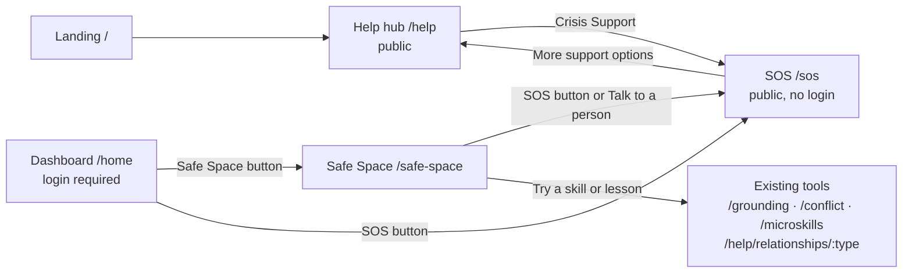
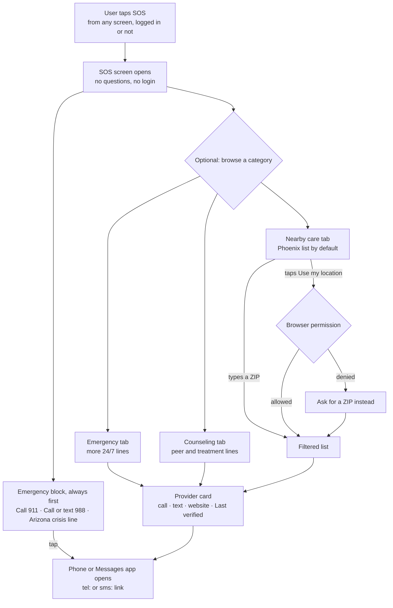
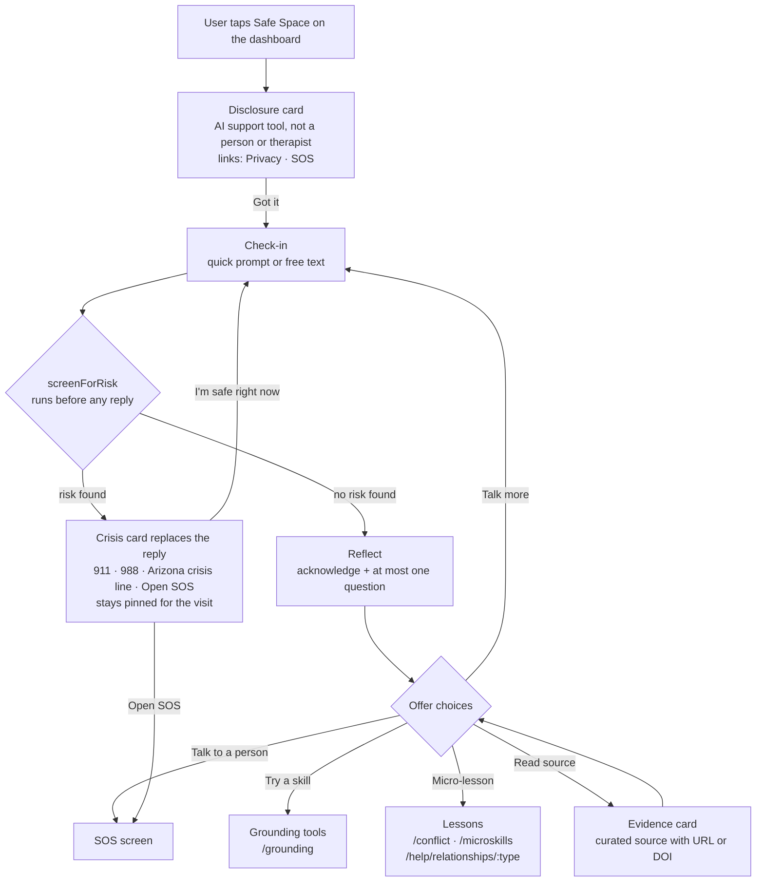

# SOS & Safe Space (LLM Assistant): User Flow

> **Status:** Draft for the UI/UX × Frontend session on Nov 10, 2026. Review it before building from it.
> **Pair:** Jaxon Richardson (UI/UX research) · Arda Dalyanci (Frontend)
> **Based on:** Jaxon's report *"Safe Space AI Companion & Phoenix SOS Support System"* (Nov 10, 2026) and `main` at `cdbc11e`.
> **This PR changes no app code.** It turns the report into flows, screens, and an implementation map so the build is straightforward.

## TL;DR

- **Two features, two jobs.** SOS gets someone to a human *fast*. Safe Space listens briefly and routes the user to the right BrightBridge tool or person. Neither one is therapy or an emergency service.
- **SOS is public and one tap away** from the dashboard, Safe Space and Help, logged in or not. Emergency numbers come first: no questions, no login, no location prompt before them.
- **Build Safe Space as Phase 1 first, with no model.** Prewritten replies sit behind one `getReply()` function. Phase 2 swaps an LLM in behind the same function, so the UI does not change.
- **Safety runs before any reply.** A deterministic `screenForRisk()` check runs on every message. A match replaces coaching with crisis options. The model never makes that call alone.
- **Fix one layout collision first.** The report puts a Privacy button at the bottom-left, which is where Quick Exit already sits on every page (`src/app/App.css:251`). See §5.

## 1. Purpose: what each feature is (and is not)

| | **Safe Space** (Bridge Buddy) | **SOS** |
|---|---|---|
| For | A teen or young adult who knows they're upset but not which tool to pick | Anyone who needs help *now* |
| Job | Listen, reflect, then offer choices: talk more, a coping skill, a micro-lesson, a source, or a person | Put emergency and support contacts one tap away from a call or text |
| Success | The user lands on a useful BrightBridge tool or reaches a human | The user reaches 911, 988, or the Arizona crisis line in 2 taps or fewer |
| It is **not** | A friend, a therapist, a diagnosis, or confidential | A dispatcher. The app cannot summon responders, and the screen must never imply it can |
| Data (Phase 1) | Nothing is stored. The chat disappears on leave or refresh | Nothing is stored. Location is used only if the user taps "Use my location" |

## 2. Where it fits in today's app

**Today on `main`:**
- The red **HELP** button sits bottom-right on Home and Daily Check-in and opens `/help`.
- Picking **Crisis Support** there shows 5 national hotlines inline (`crisisResources` in `src/content/appContent.js`).
- **Quick Exit** is fixed bottom-left on every page.
- `/grounding`, `/conflict`, `/microskills`, and `/resources` are still Coming Soon pages.

**Proposed navigation.** Every screen also keeps Quick Exit and Privacy (§5).



## 3. SOS flow



**The SOS screen, top to bottom:**

1. **Header:** "SOS" with a back link. Subtitle: *"Quick access to help when you need it."*
2. **Emergency block.** It always comes first, with the largest buttons, in this order:
   - **Call 911**: "Immediate danger"
   - **Call or text 988**: Suicide & Crisis Lifeline (two buttons: call, text)
   - **Arizona crisis line**: 1-844-534-4673, 24/7

   The mockup also lists Teen Lifeline and the Phoenix walk-in right below. That is fine as long as these three stay first.
3. **Category tabs (optional):** Emergency · Counseling · Nearby care. Add a service-type filter: youth, peer, abuse, sexual assault, LGBTQ+.
4. **Provider card:**
   - Name, a call button, a text button, and the official website.
   - Address and directions only for physical sites.
   - Hours only if verified. Languages and accessibility only if confirmed.
   - Always **"Last verified: <date>"**.
5. **Nearby care:**
   - Shows the Phoenix list by default without using location.
   - The user can type a ZIP or tap **Use my location**. That tap is the only moment the browser permission prompt may appear. If it is denied, fall back to the ZIP box.
   - Distance is computed on the device. Location is never sent or stored.
   - With one verified physical site today, a list plus a ZIP filter is enough. Distance sorting can wait until the directory grows.
6. **Footer:** *"Support listings are not exhaustive. For a medical emergency, call 911."*
7. **Persistent:** Quick Exit and Privacy (§5).

## 4. Safe Space flow



From any step, SOS and Quick Exit are one tap away. In Phase 1, Back or **Stop** clears the chat.

| Step | What the user sees | Rules |
|---|---|---|
| **1. Entry** | Header "Safe Space" with back and a red **SOS** button. Bridge Buddy avatar. A disclosure card: *"I'm Bridge Buddy, an AI support tool, not a person or therapist. You can stop anytime."* It links to **Privacy** and **SOS**. | Show it before the first message on every new visit. Footer under the chat: *"AI support, not emergency care."* |
| **2. Check-in** | Quick prompts: *I feel overwhelmed* · *I had a conflict* · *I feel lonely* · *I need support*. An optional text box. | Free text is never required to get help. |
| **3. Safety screen** | Nothing visible. | `screenForRisk(text)` runs on **every** user message before any reply. It uses deterministic rules, not the model. |
| **4. Reflect** | One short acknowledgement and at most **one** gentle question. | No diagnosis. Never "I feel…". Never promise secrecy. Never suggest the bot is all they need. |
| **5. Choices** | 3 to 5 buttons (see the table below). | Every choice leads somewhere real: a route, the SOS screen, or "talk more". |
| **6. Evidence card** | Skill name, a one-line description, source and year, a **Read source** link, and the label *"General wellness suggestion, not a treatment."* | Only from the curated `evidence.js` list, with an exact URL or DOI. No source on file means no button. Never generate citations. |
| **7. Escalation** | A crisis card replaces the reply: **Call 911 · Call or text 988 · Arizona crisis line · Open SOS**. | Ordinary coaching stops. The crisis options stay pinned at the top for the rest of the visit (decision 4). |
| **8. Leave** | Back, or **Stop**. | Phase 1 keeps the chat in React state only. Leaving or refreshing clears it. |

### Phase 1 scripted replies

Draft copy. Peer Solutions must approve it before testing with youth.

| Quick prompt | Bridge Buddy says | Choices → destination |
|---|---|---|
| I feel overwhelmed | "That sounds like a lot to carry. Thanks for telling me. Would a short grounding exercise help right now?" | Try grounding → `/grounding` · Talk more · Talk to a person → SOS Counseling tab |
| I had a conflict | "Conflict with someone you care about can really hurt. Who was it with?" | Partner / Friend / Family / Other → `/help/relationships/:type` · Show a pause-and-repair script in the chat (*"I want to understand what happened. Can we talk when we both feel calmer?"*) · Conflict de-escalation → `/conflict` |
| I feel lonely | "Feeling lonely is hard, and it's okay to say so. Is there one person you trust you could reach out to today?" | Ideas for a small connection (in the chat) · Talk to a peer → SOS Counseling tab · Talk more |
| I need support | "I'm glad you reached out. Would you rather talk to a real person, or try something on your own first?" | Talk to a person → SOS · Try grounding → `/grounding` · See all help → `/help` |
| Free text, no risk found | "Thanks for telling me. I'm an early prototype and can't fully understand typed messages yet. Which of these is closest?" | The four quick prompts again · Talk to a person → SOS |

### What `screenForRisk` catches

`screenForRisk` returns one category, and that category picks the crisis card:

| Category | Crisis card emphasis |
|---|---|
| Self-harm or suicide | 988 first |
| Someone hurting me, or I'm not safe at home | 911 if in danger now; DV and RAINN lines |
| Medical emergency (e.g., overdose, can't breathe) | 911 first |
| Threat to others | 911 first |

The phrase list belongs in `safetyScreen.js`. UI/UX and Peer Solutions review it. Expect both false positives and false negatives, and test both (§7).

## 5. Persistent controls: fix the layout collision first

| Control | Today on `main` | Proposed | Why |
|---|---|---|---|
| **Quick Exit** | Fixed bottom-left on every page (`App.css:251`), 40px tall | **Keep it where it is.** Raise its height to 44px or more. | It is a shipped safety control, and moving it breaks muscle memory. The report requires 44 × 44px touch targets. |
| **Privacy** | n/a | Bottom-left, **stacked directly above Quick Exit**, on every page | The report asks for bottom-left. Stacking avoids the overlap. |
| **SOS** | Red **HELP** button, bottom-right on Home and Daily Check-in, opens `/help` | Same spot and red style, labelled **SOS**, opens `/sos`. Also shown on Safe Space and Help. | One name for the emergency entry everywhere, and one tap to the numbers. |
| **Safe Space** | n/a | A wide rounded button on the dashboard below the nav, with a chat-bubble icon and the label exactly "Safe Space" | It never replaces or hides SOS. |

If SOS replaces HELP, the dashboard card "Tap the red HELP button anytime…" needs its copy updated too.

**Privacy sheet: Phase 1 copy, in plain language.**
- Your daily check-in mood and journal entries are saved to your account.
- Safe Space conversations are **not** saved. They disappear when you leave or refresh.
- Bridge Buddy is not a counselor and not a confidential clinical service.
- Location is used only if you tap "Use my location", and it never leaves your device.
- Quick Exit opens a neutral website. It cannot erase your browser history or stop someone from monitoring your device. Private browsing helps.

## 6. Implementation map

**Routes** (`src/app/App.jsx`):
- `/sos` → `SosPage`, **outside** `ProtectedRoute`. SOS must never require login.
- `/safe-space` → `SafeSpacePage`, inside `ProtectedRoute` (decision 3).
- `/help` → "Crisis Support" navigates to `/sos` instead of rendering its own list, so there is one crisis directory.

**New files:**

| File | Purpose |
|---|---|
| `src/content/sosResources.js` | The single source of truth for every crisis and support contact. It replaces `crisisResources`. |
| `src/pages/SosPage.jsx` | Emergency block, tabs, provider cards, Nearby care |
| `src/pages/SafeSpacePage.jsx` | The chat shell: disclosure, transcript, quick prompts, choice buttons, crisis card |
| `src/features/safeSpace/safetyScreen.js` | `screenForRisk(text)`, a pure, unit-tested function |
| `src/features/safeSpace/scriptedReplies.js` | Phase 1 content from the tables in §4 |
| `src/features/safeSpace/getReply.js` | The seam between Phase 1 (scripted) and Phase 2 (server) |
| `src/features/safeSpace/evidence.js` | Curated evidence cards. An exact URL or DOI is required. |

**Reuse:**
- `PageHeader` and `QuickExit`.
- The `.help-fab` styles, which become `SosButton`.
- `relationshipTypes` for the conflict picker.
- The existing Coming Soon routes as destinations until those tools exist.

**The seam that keeps Phase 2 cheap:**

```js
// getReply.js: the UI only ever calls this.
export async function getReply({ promptId, text }) {
  const risk = screenForRisk(text) // always first; never the model's call
  if (risk.level === 'urgent') return crisisReply(risk.category)
  return scriptedReply(promptId, text)
  // Phase 2: POST to a server endpoint here instead,
  // then run screenForRisk on the model's output too.
}
```

**Data shapes:**

```js
// sosResources.js: one entry
{
  id: 'az-crisis-line',
  name: 'Arizona statewide crisis line',
  tab: 'emergency',         // 'emergency' | 'counseling' | 'nearby'
  pinned: true,             // true only for the three required top entries
  tags: ['24/7'],           // also 'youth' | 'peer' | 'abuse' | 'sexual-assault' | 'lgbtq'
  phone: '18445344673',     // digits only, for tel:
  phoneLabel: '1-844-534-4673',
  sms: null,                // e.g. { number: '988', body: '' }
  url: null,                // official website
  address: null,            // physical sites only
  coords: null,             // { lat, lng }, physical sites only, for on-device distance
  hours: null,              // only when verified
  lastVerified: null,       // 'YYYY-MM-DD', shown on the card
  sourceUrl: 'https://www.azahcccs.gov/behavioralhealth/crisis.html',
}

// One Safe Space message (React state only in Phase 1)
{ id, role: 'buddy' | 'user', kind: 'disclosure' | 'text' | 'crisis' | 'evidence', text, choices: [{ label, to }] }
```

<details>
<summary><b>Seed directory for <code>sosResources.js</code></b>: from Jaxon's report §9 plus the lines already in the app. Recheck every number against its source before launch.</summary>

| Tab | Entry | Contact | Note |
|---|---|---|---|
| Pinned | Emergency (police, fire, medical) | 911 | Dispatch, no address |
| Pinned | 988 Suicide & Crisis Lifeline | Call or text 988 | National, 24/7 |
| Pinned | Arizona statewide crisis line | 1-844-534-4673 | Statewide, 24/7 |
| Emergency | Maricopa crisis hotline | 1-800-631-1314 | County crisis support |
| Emergency | Teen Lifeline | 602-248-8336 | Phoenix-area youth support |
| Emergency | Terros Health crisis line | 602-685-6000 | 24/7 |
| Emergency | Phoenix Community Assistance Program | 602-261-8849 | Verify dispatch coverage |
| Emergency | Crisis Text Line | Text HOME to 741741 | Already in the app |
| Emergency | National Domestic Violence Hotline | 1-800-799-7233 · text START to 88788 | Already in the app |
| Emergency | RAINN Sexual Assault Hotline | 1-800-656-4673 · text HOPE to 64673 | Already in the app |
| Emergency | The Trevor Project | 1-866-488-7386 · text START to 678678 | Already in the app |
| Counseling | Solari peer support line | 602-347-1100 | Peer support |
| Counseling | SAMHSA treatment referral | 1-800-662-4357 | National referral |
| Nearby care | Phoenix 24/7 walk-in intake | 1-855-245-6350 | 4136 N. 75th Ave., Suite 116, Phoenix, AZ 85033 |

Sources listed in the report: AHCCCS crisis hotlines, City of Phoenix crisis hotlines and treatment centers, PHX Mental Health Matters, and the Solari Crisis Response Network.

</details>

## 7. Acceptance checks (definition of done for the build)

**SOS**
- [ ] `/sos` loads while logged out (test in a private window).
- [ ] The SOS screen is one tap from Home, Daily Check-in, Safe Space, and Help. Calling 911 or 988 takes at most two taps.
- [ ] Nothing appears before the emergency block: no form, question, login, or location prompt.
- [ ] Every `tel:` and `sms:` link dials the number shown in its label. Add a unit test over `sosResources.js`.
- [ ] The location prompt appears only after tapping "Use my location". Denying it falls back to the ZIP box.
- [ ] Every card shows "Last verified". A card without verified hours shows no hours.
- [ ] The emergency numbers still render with the network off after the first load, because the data is bundled and never fetched. Full offline support needs a service worker, which the repo does not have yet.

**Safe Space**
- [ ] The disclosure appears before the first message on every new visit.
- [ ] The SOS button stays visible on Safe Space, including while the mobile keyboard is open.
- [ ] Crisis test phrases show the crisis card instead of a reply. Examples: "I want to kill myself", "he hits me", "I took too many pills". Cover them with unit tests on `screenForRisk` plus one UI test.
- [ ] Everyday phrases get a normal reply. Example: "this homework is killing me". Log false positives during testing.
- [ ] Each choice button lands on the right route. Coming Soon pages are fine for now.
- [ ] No evidence card renders without an exact URL or DOI from `evidence.js`.
- [ ] Leaving or refreshing clears the chat. Phase 1 writes nothing to `localStorage` and sends nothing to a server.
- [ ] A copy review confirms Bridge Buddy never says "I feel", never promises secrecy, and never names a diagnosis.

**Both screens**
- [ ] Touch targets are at least 44 × 44px.
- [ ] Urgency never relies on color alone: emergency buttons carry text labels.
- [ ] New chat messages are announced with `aria-live="polite"`.
- [ ] Animations respect `prefers-reduced-motion`.
- [ ] Both screens work at 320px width, at 200% zoom, and with the keyboard only.

## 8. Phases (from the report §12)

| Phase | Safe Space | SOS |
|---|---|---|
| **1: build now** | Scripted replies. No model, no storage. The safety screen runs on the client. | A static directory bundled in the app, with `lastVerified` dates |
| **2: pilot** | An LLM with retrieval over Peer Solutions-approved content, called through a server endpoint (never from the browser, which would expose the API key). Rate-limited; `backend-express` already has `netlify/functions/infrastructure/ratelimiter.js`. The safety screen runs on the input and on the model's output. No training on conversations. Written retention and deletion rules. | The directory moves to a maintained source with a regular verification check |
| **3: evaluate** | Youth usability and outcome testing with Peer Solutions, plus clinician-reviewed safety simulations. Never test with real emergencies. | Ongoing directory audits |

## 9. Decisions needed

| # | Question | Recommendation |
|---|---|---|
| 1 | Should SOS replace the red HELP button, or should both exist? | **Replace it.** Keep the same spot and style, labelled SOS, opening `/sos`. Two red buttons with different names confuse people in a crisis. |
| 2 | Where does the Privacy button go? | **Stack it above Quick Exit** at the bottom-left. Quick Exit stays where it is. |
| 3 | Should `/safe-space` require login? | **Yes.** Its entry point is the dashboard, and Phase 2 needs a verified user for rate limiting. SOS stays public. |
| 4 | Can the user keep chatting after a crisis card? | **Yes**, through "I'm safe right now", with the crisis options pinned for the rest of the visit. Peer Solutions should confirm. |
| 5 | Phase 1 replies are prewritten. Should the disclosure still say "AI support tool"? | Say **"automated support tool (prototype)"** until a model is actually connected. |
| 6 | Who re-verifies the SOS numbers, and how often? | UI/UX research, monthly and before every release. Each check updates `lastVerified`. |
| 7 | The mockup uses burgundy and peach, but `tokens.css` has purple, pink, and coral. Which palette wins? | UI/UX supplies the token values. Frontend changes only `tokens.css`. |
| 8 | Quick Exit is a normal link, so the browser's Back button returns to the page. Should that change? | A separate small fix: use `window.location.replace()`. Out of scope for this doc. |

---

**AI use (EPICS syllabus):** Claude Code (Claude Opus 5.5, max reasoning effort) was used to read Jaxon Richardson's research report and the current `main` branch, and to draft this user-flow document and its diagrams at Arda Dalyanci's direction. The draft goes to Jaxon and the UI/UX team for review before anyone builds from it.
